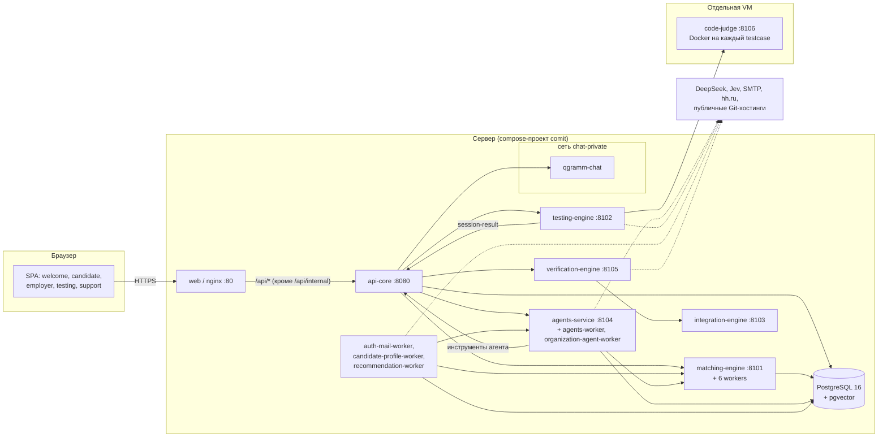
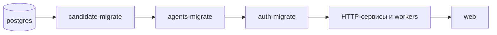
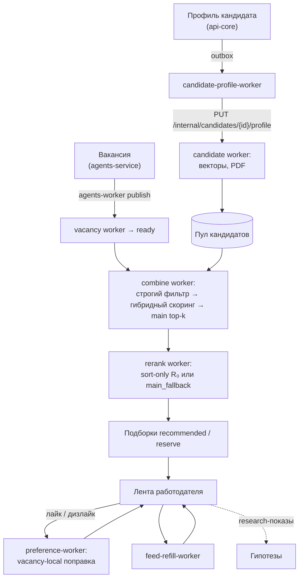
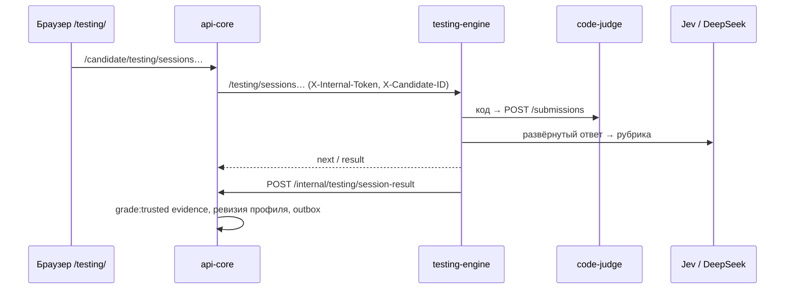
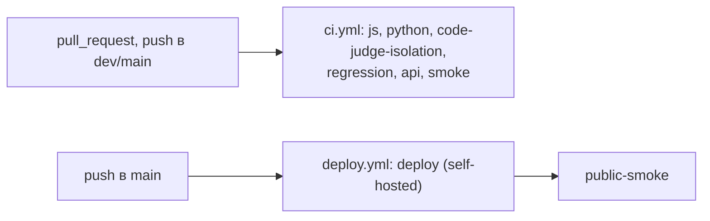

# Архитектура в диаграммах

Диаграммы Mermaid по фактической конфигурации `infra/docker-compose.yml`,
`infra/nginx/nginx.conf` и `.github/workflows/*`. Текстовое описание контуров —
[architecture.md](architecture.md), карточки сервисов — [services.md](services.md).

## Контейнеры и связи

Наружу смотрит только web; служебные порты публикуются на `127.0.0.1` для smoke и
диагностики. Межсервисные вызовы защищены токенами (`CANDIDATE_PIPELINE_TOKEN`,
`AGENTS_SERVICE_TOKEN`, `TESTING_ENGINE_TOKEN`, `VERIFICATION_ENGINE_TOKEN`,
`CHAT_SERVICE_TOKEN`, `CODE_JUDGE_TOKEN`).

## Порядок старта

## Конвейер подбора

Подробности этапов — [matching.md](matching.md), [preference-learning.md](preference-learning.md),
[hypothesis-learning.md](hypothesis-learning.md), [feed-refill.md](feed-refill.md).

## Адаптивный тест

Таймауты прокси api-core: 65 с для `answer`, 25 с для остальных вызовов, тело до
3.1 MB ([testing-engine.md](testing-engine.md)).

## CI/CD

Состав job-ов, раннеры и пороги покрытия — [ci.md](ci.md), выкладка — [deploy.md](deploy.md).
