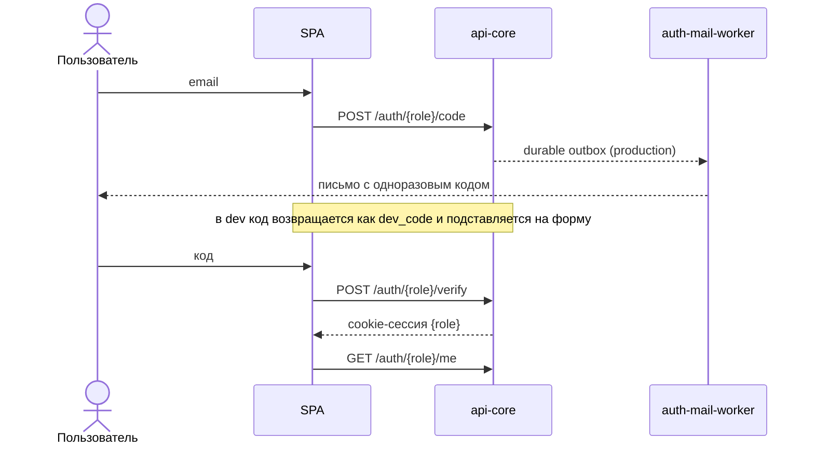
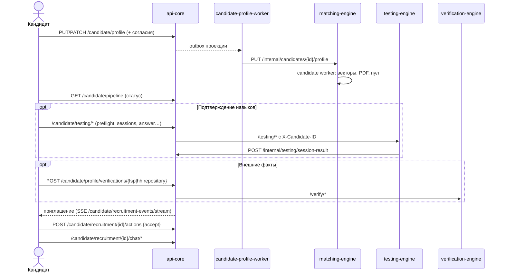
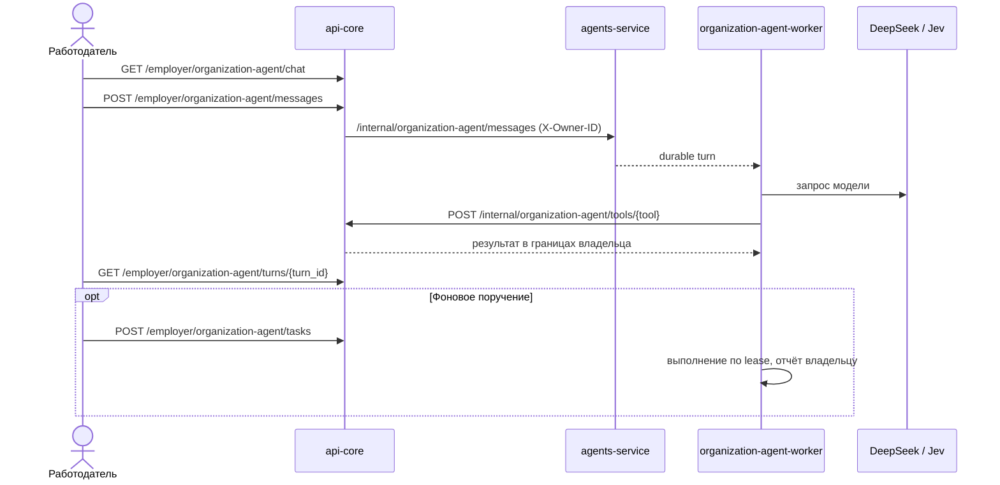

# Пользовательские сценарии от начала до конца

Три основных сценария — кандидат, работодатель и AI-агент работодателя — с
маршрутами API и участвующими сервисами. Пути указаны относительно api-core;
браузер вызывает их с префиксом `/api`. Полный список маршрутов —
[api-reference.md](api-reference.md), состояния найма — [recruitment.md](recruitment.md).

## Вход (общий для ролей)



`{role}` — `candidate` или `employer`; роли изолированы и имеют разные cookie.
Выход — `POST /auth/{role}/logout`, со всех устройств — `logout-all` ([auth.md](auth.md)).

## Кандидат



1. **Профиль.** `GET /candidate/profile` возвращает текущий профиль или
   состояние создания; `PUT` создаёт, `PATCH` правит с `expected_revision`.
   Резюме можно предзаполнить импортом PDF/фото (`POST /candidate/profile/import`,
   [resume-import.md](resume-import.md)). Согласие на обработку и показ в подборе
   отделено от согласия регистрации; согласие на обучение моделей — отдельное и
   необязательное ([candidate-profile.md](candidate-profile.md)).
2. **Попадание в пул.** `candidate-profile-worker` отправляет снимок в
   matching-engine, где candidate worker строит векторы и PDF. Статус —
   `GET /candidate/pipeline`; после ошибки — `POST /candidate/profile/projection/retry`.
3. **Подтверждение навыков.** `GET /candidate/testing/preflight` показывает
   доступность попытки и cooldown; `POST /candidate/testing/sessions` создаёт
   попытку, затем `next`/`answer` до решения, `supervision`/`media`, `finish`,
   `result`. Результат публикуется доверенным publisher-ом и становится
   `grade:trusted` evidence. Повтор — через 7 дней, повышение — через 30
   ([testing-engine.md](testing-engine.md)). История —
   `GET /candidate/testing-history`, недельное задание —
   `/candidate/weekly-challenge` ([weekly-challenges.md](weekly-challenges.md)).
4. **Внешние факты.** ФСП (в т.ч. демо-привязка `/candidate/profile/fsp/demo/*`),
   публичный Git-репозиторий, резюме hh.ru и документы-доказательства
   ([verification.md](verification.md), [fsp-link.md](fsp-link.md)).
5. **Приглашения.** Список — `GET /candidate/recruitment`, события —
   `GET /candidate/recruitment-events` и SSE-поток. Кандидат видит описание и
   зарплату «от–до» до принятия; действия — `view`, `accept`, `decline`,
   `withdraw`, `interview_accept`/`interview_decline`, `offer_accept`/`offer_decline`.
   Принятие оффера переводит процесс в `hired` и добавляет запись в опыт работы.
6. **Общение.** Чат процесса — `/candidate/recruitment/{id}/chat/*` (QGramm,
   [chat.md](chat.md)); уведомления платформы и поддержка — системный чат
   `/candidate/system-chat` ([system-inbox.md](system-inbox.md)).
7. **Рекомендации.** `GET /candidate/recommendations/latest` — обезличенные
   недельные советы по профилю ([recommendations.md](recommendations.md)).

## Работодатель

```mermaid
sequenceDiagram
  actor E as Работодатель
  participant A as api-core
  participant AS as agents-service
  participant ME as matching-engine
  E->>A: PATCH /employer/profile (название компании)
  E->>A: POST /employer/vacancies → PATCH …
  A->>AS: /internal/vacancies (X-Owner-ID из сессии)
  E->>A: POST /employer/vacancies/{id}/approve → /publish
  AS-->>ME: agents-worker публикует вакансию; vacancy worker → ready
  ME->>ME: combine worker → main top-k → rerank worker
  E->>A: GET /employer/vacancy-drafts/{id}/selections
  E->>A: POST /employer/vacancy-drafts/{id}/feed → decisions
  ME->>ME: preference-worker, feed-refill-worker
  E->>A: POST /employer/vacancy-drafts/{id}/invitations
  E->>A: POST /employer/recruitment/{id}/actions (interview_*, offer_send)
  E->>A: GET /employer/recruitment/{id}/contacts (после accept)
```

1. **Компания.** Название хранится в профиле работодателя
   (`GET/PATCH /employer/profile`); без него приглашение отклоняется
   (`employer_company_required`).
2. **Вакансия.** Форма или AI-агент редактируют один черновик в agents-service
   (`/employer/vacancies`, [vacancy-crud.md](vacancy-crud.md)). Публикация —
   явная цепочка approve → summary → publish; создание и правки сами ничего
   не публикуют. Снятие (`withdraw`), закрытие (`close`) и удаление доступны там же.
3. **Подборка.** После публикации `agents-worker` передаёт вакансию в
   matching-engine, vacancy worker готовит её, combine
   worker строит main top-k (строгий фильтр → гибридный скоринг), rerank worker
   упорядочивает его активным R₀. Готовность — `GET …/ready`, подборки —
   `GET …/selections` с объяснением факторов попадания ([matching.md](matching.md)).
4. **Лента.** `POST …/feed` открывает сессию, `…/feed/impressions` фиксирует
   показы, `…/feed/decisions` — лайк/дизлайк. Реакции обучают vacancy-local
   preference-модель (только для кандидатов с training-согласием), feed-refill
   добирает ленту, в неё встроены research-показы гипотез
   ([preference-learning.md](preference-learning.md), [hypothesis-learning.md](hypothesis-learning.md),
   [feed-refill.md](feed-refill.md)). Сохранённые и просмотренные — `…/saved`, `…/visited`.
5. **Витрина и поиск.** `POST /employer/candidates/search` и карточка
   `GET /employer/candidates/{id}` позволяют найти кандидата вне подборки
   ([candidate-showcase.md](candidate-showcase.md)).
6. **Приглашение.** `POST /employer/vacancy-drafts/{id}/invitations` с
   описанием и, при необходимости, своей вилкой зарплаты (иначе берётся вилка
   вакансии). Отказ до приглашения — `…/recruitment/reject`, кандидат его не видит.
7. **Процесс найма.** Собеседования (`interview_propose`, `interview_cancel`,
   `interview_complete`), оффер (`offer_send`), отказ (`reject`). Контакты
   открываются только после принятия приглашения через
   `GET /employer/recruitment/{id}/contacts`.
8. **Статистика и расходы.** `GET /employer/statistics`
   ([employer-statistics.md](employer-statistics.md)); начисления по политике
   `expense-v1` описаны в [api.md](api.md).

## AI-агент работодателя



- **Черновик вакансии.** `POST /employer/agents/sessions` и `…/turns` ведут
  редакционный диалог над тем же черновиком; `…/enrich` дополняет требования.
  `GET /employer/agents/capabilities` сообщает, доступны ли агент и enrichment;
  при `AGENTS_MODE=manual` или недоступном провайдере остаётся ручная форма
  ([agents-offline.md](agents-offline.md)).
- **Глобальный чат.** Один чат на аккаунт: сообщения, история, память
  (`…/memory`), документы TXT/MD/PDF (`…/documents`), бюджет (`…/budget`,
  окно 7 дней). Инструменты агента вызывают api-core от имени владельца и
  проходят те же проверки доступа, что и кабинет ([agents.md](agents.md)).
- **Фоновые поручения и офлайн-дублёр.** `…/tasks` создаёт поручение
  (например, опрос кандидата или согласование собеседования), `…/presence`
  сообщает присутствие владельца, `…/pending-answers` — вопросы, ждущие решения.
  Поручения выполняются `organization-agent-worker` независимо от открытой вкладки.
- **Jev в ленте.** Агент может просмотреть до 50 карточек с комментарием и
  предложить решения в границах владельца ([agents.md](agents.md)); подсказки
  Jev при заполнении вакансии — [vacancy-suggestions.md](vacancy-suggestions.md).

## Оператор поддержки

Оператор входит на `/support/` по `SUPPORT_EMAIL` и `SUPPORT_ACCESS_KEY`
(`POST /support/login`, сессия 7 дней), видит обращения
`GET /support/conversations` и отвечает в системный чат пользователя
([support-console.md](support-console.md)).
